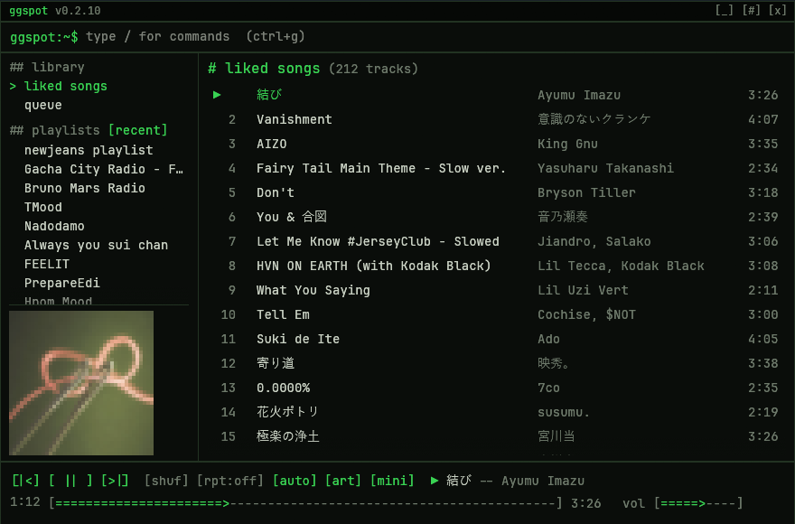
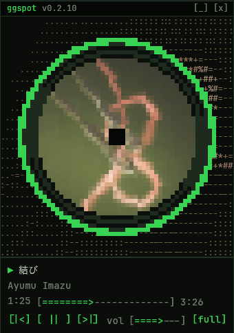

# GGspot

A tiny, terminal-style Spotify player for Windows. It's for listening and nothing else: search, playlists, liked songs, artist pages, shuffle, repeat and autoplay. Covers are drawn as chunky colour blocks. No home feed, no browser engine.

Built with Rust, [egui](https://www.egui.rs) and [librespot](https://github.com/librespot-org/librespot). **Playback needs Spotify Premium.**



Press `Ctrl+M` for mini mode: a spinning record over the cover in coloured ASCII.



## Why it's fast

- **Instant start.** The library is cached on disk, so it shows up on the first frame (about 100 ms). It refreshes in the background.
- **No shared API quota.** Library, playlists, search and artist pages go through the same per-user client API the Spotify app uses. Nothing goes through a rate-limited shared developer app.
- **Only what changed.** A playlist is re-downloaded only when its revision changes, and every playlist is pre-fetched in the background (4 at a time).
- **Batched metadata.** Track info is fetched 200 tracks per request.
- **Search as you type.** Your own library is filtered instantly. Spotify is queried 250 ms after you stop typing, and stale requests are cancelled.

## Use

1. Run `ggspot.exe` and press **[ login with spotify ]**. This opens the normal Spotify login page in your browser (email, Google or Apple). You only do this once.
2. Double-click a song to play it. Click an artist name to see their top tracks and discography. Rest the pointer on a song to see its cover in ASCII.
3. When the queue runs out, **[auto]** keeps going with similar songs, like Spotify's autoplay. Open **queue** in the sidebar to see what's next.

| Key | Action |
|---|---|
| `Space` | play / pause |
| `Ctrl+G` | command line: type `/` to see every command |
| `Ctrl+F` | command line with `/srh` already typed |
| `Esc` / `Backspace` | clear the command line / back from artist page / leave mini mode |
| `Ctrl+Left` / `Ctrl+Right` | previous / next |
| `Ctrl+S` | shuffle on / off |
| `Ctrl+R` | repeat: off, all, one |
| `Ctrl+O` | sort playlists: recent, custom, a-z |
| `Ctrl+I` | album cover on / off |
| `Ctrl+M` | mini mode: a spinning record over the cover in ASCII |
| `Alt+Up` / `Alt+Down` | move the open playlist (saves as your custom order) |
| `Up` / `Down`, `Enter` | select, play |

## Commands

Press `Ctrl+G` and type `/`. Suggestions appear as you type: `Up` / `Down` to choose, `Tab` to complete, `Enter` to run.

| Command | Action |
|---|---|
| `/srh <song or artist>` | search your library and Spotify |
| `/play [song]` | play the top match, or resume |
| `/pause`, `/next`, `/prev` | playback |
| `/shuf`, `/rpt`, `/auto`, `/art` | same as the buttons |
| `/vol <0-100>` | set the volume |
| `/mini` | spinning record mode |
| `/liked`, `/queue`, `/open <playlist>` | go somewhere |
| `/sort` | sort playlists: recent, custom, a-z |
| `/help`, `/quit` | list everything, close GGspot |

`ggspot.exe --offline` browses the cached library without touching the network.

Data lives in `%LOCALAPPDATA%\ggspot`: the library cache, your saved login and a 1 GB audio cache, and small cover files. Delete the `credentials` folder there to log out.

## Build

```
cargo build --release
```

`cargo run --release --example smoke` exercises login, search and artist pages without the UI.

GGspot is an independent project and is not affiliated with Spotify.
